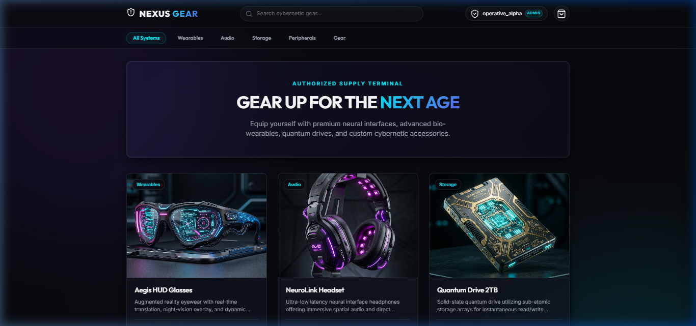
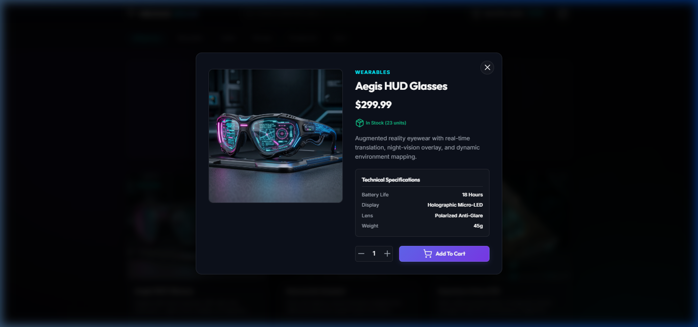
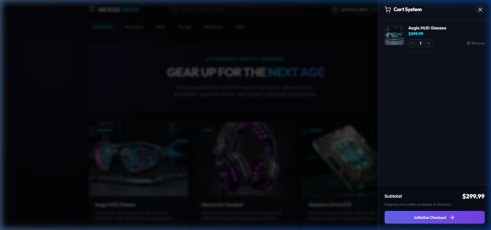
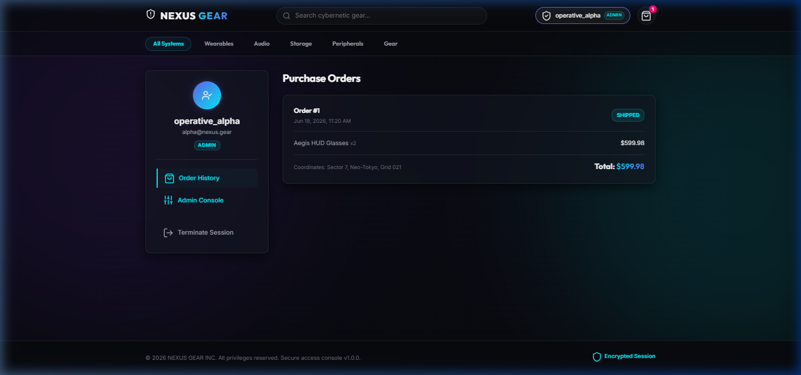
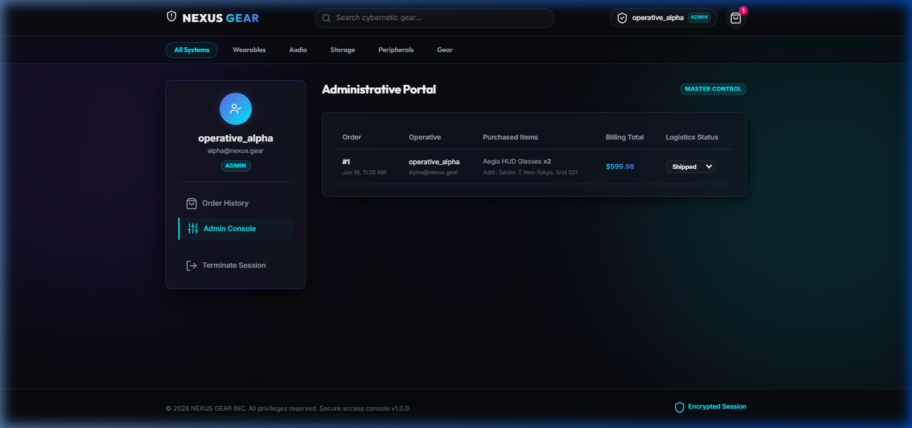

<div align="center">

# ⚙️ NEXUS GEAR

### Futuristic Cybernetic Storefront — Thematic Glassmorphism SPA with SQLite & Node Backend

[](https://nodejs.org/)
[](https://expressjs.com/)
[](https://www.sqlite.org/)
[](https://www.docker.com/)
[](https://jwt.io/)
[](LICENSE)

<br/>

> **NEXUS GEAR** is a premium, high-fidelity cybertech accessories e-commerce storefront. Authenticate with secure JWT credentials, browse glowing catalog items in a glassmorphic dashboard, select quantities, view real-time inventory levels, place checkout orders utilizing transactional database security, and manage logistics status updates through the admin console.

<br/>

   

</div>

---

## 📋 Table of Contents

- [Overview](#-overview)
- [Product Preview](#-product-preview)
- [Features](#-features)
- [Architecture](#-architecture)
- [Tech Stack](#-tech-stack)
- [Project Structure](#-project-structure)
- [Installation](#-installation)
- [Usage](#-usage)
- [API Reference](#-api-reference)
- [Configuration](#-configuration)
- [Security Notes](#-security-notes)
- [Design Decisions](#-design-decisions)
- [License](#-license)

---

## 🧠 Overview

NEXUS GEAR targets a secure, modern, and highly interactive online store workflow. The backend provides secure JWT sessions over HttpOnly cookies, serves API requests, and executes relational SQL transactions to prevent checkout stock race conditions. The client-side dashboard renders a futuristic cybertech layout featuring real-time state synchronization for user accounts and carts.

Users can:
- Explore seeded premium items (like Aegis HUD Glasses or NeuroLink Headset)
- Query items instantly via debounced searches and category filters
- Register profiles and login (the first registrant is promoted to Admin automatically)
- Modify, increment, and persist their shopping cart state across sessions via LocalStorage
- Authorize order deliveries via coordinates and track order statuses
- Access the Admin Console (if Admin) to update global order statuses in real-time

---

## 🖼️ Application Preview

<div align="center">

### 1) Storefront Landing Grid



<br/>

### 2) Detailed Product Inspection Modal



<br/>

### 3) Interactive Cart Drawer



<br/>

### 4) Operative Profile and Order History



<br/>

### 5) Administrative Dashboard Table



</div>

---

## ✨ Features

| Feature | Description |
|---|---|
| 🛒 **Sliding Cart Drawer** | Sidebar drawer displaying items, prices, quantity adjustments, and LocalStorage persistence |
| 🔍 **Live Search & Category Filters** | Instant, live list filtering using category tag toggles and debounced text inputs |
| 🔐 **JWT cookie Sessions** | Secure authentication and automatic state updates using HttpOnly cookies |
| 🛡️ **Admin Console Dashboard** | Interactive list displaying order IDs, purchased goods, billing totals, and status drop-down editors |
| 📈 **Transactional Checkouts** | Relational SQL transaction checks ensuring orders only complete if stock is available |
| 🐳 **Dockerization Setup** | Quick container configuration running Node.js Alpine and mapping persistent SQLite database volumes |
| 🎨 **Glassmorphism Design System** | Vibrant dark mode layout, glowing CSS grid cards, Outfit & Inter typography, and Lucide icons |

---

## 🏗️ Architecture

```
┌───────────────────────────────────────────────────────────────────┐
│                         NEXUS GEAR SPA UI                         │
│                                                                   │
│  Home View ──► Details Modal ──► Cart Drawer ──► Checkout Form     │
│      │              │               │                 │           │
│      └────── GET /products ◄────────┴────────── POST /orders      │
│                                                                   │
│                     Profile & Admin Console                       │
│             (Order History, Status Update PATCH)                  │
└──────────────────────────────┬────────────────────────────────────┘
                               │
                               ▼
┌───────────────────────────────────────────────────────────────────┐
│                           Express Backend                         │
│                                                                   │
│  Middleware: CORS + Cookie Parser + Token Authentication          │
│                                                                   │
│  /api/products  ─► productController.js                           │
│  /api/auth      ─► authController.js                              │
│  /api/orders    ─► orderController.js (SQLite Transactions)       │
│                                                                   │
│  database.sqlite stores users, products, orders, order_items      │
└───────────────────────────────────────────────────────────────────┘
```

---

## 🛠️ Tech Stack

| Layer | Technology |
|---|---|
| **Backend** | Node.js, Express.js, Cookie-Parser, JWT (`jsonwebtoken`), Hashing (`bcryptjs`) |
| **Persistence** | SQLite (`sqlite`, `sqlite3` driver) |
| **Frontend** | Semantic HTML5, Custom Glassmorphic CSS3, ES6 Vanilla JavaScript, Lucide Icons |
| **Containerization**| Docker, Docker Compose |
| **Dev Tooling** | Nodemon, Dotenv |

---

## 📁 Project Structure

```
E-commerce store/
│
├── public/                      # Static Web Client (SPA)
│   ├── assets/
│   │   └── products/            # Seeded Product Images
│   ├── css/
│   │   └── style.css            # Glassmorphism Design System
│   ├── js/
│   │   ├── api.js               # REST Client API Wrappers
│   │   ├── cart.js              # Cart State and Drawer Renderer
│   │   ├── auth.js              # Session Controller & Auth Modals
│   │   └── app.js               # Master Router & View Controllers
│   └── index.html               # Main SPA Entry Layout
│
├── src/                         # Server API Source
│   ├── config/
│   │   └── db.js                # SQLite Tables & Seed Loader
│   ├── controllers/
│   │   ├── authController.js    # User accounts and Cookie Issuance
│   │   ├── orderController.js   # Transaction checkouts & Admin status patches
│   │   └── productController.js # Catalog retrieval queries
│   ├── middleware/
│   │   └── authMiddleware.js    # JWT decoders and Admin guards
│   ├── routes/
│   │   ├── authRoutes.js
│   │   ├── orderRoutes.js
│   │   └── productRoutes.js
│   └── app.js                   # Middleware routing registry
│
├── .dockerignore
├── .env.example
├── Dockerfile
├── docker-compose.yml
├── MEMORY.md                    # Long-Term Project Memory
├── memory/                      # Daily Developer Notes
├── package.json
├── server.js                    # Server Bootstrapper
└── database.sqlite              # Relational DB File (Local Dev)
```

---

## 🚀 Installation

### 1) Clone
```bash
git clone https://github.com/your-username/nexus-gear.git
cd nexus-gear
```

### 2) Local Setup
```bash
# Install NPM dependencies
npm install

# Copy environment template
copy .env.example .env

# Start dev server
npm run dev
```
Open `http://localhost:3000` to browse the grid.

### 3) Docker Setup
```bash
# Build and spin up containers
docker compose up --build -d

# Stop container services
docker compose down
```

---

## 💻 Usage

1. **Browsing**: Toggle categories (Goggles, Audio, Accessories, Storage) and search in real-time.
2. **Registration**: Click "Sign In", select "Register Profile". Fill details. First registered user automatically becomes the store **Admin**.
3. **Cart Operations**: Click "Add" or open detail modal to adjust count. Adjust item counts inside the cart drawer.
4. **Checkout**: Enter address coordinates in Checkout view and place order.
5. **Logistics Management**: Log into an admin profile, open "Admin Console", and switch the shipping status dropdown.

---

## 📡 API Reference

| Method | Endpoint | Description | Auth Requirement |
|---|---|---|---|
| `GET` | `/api/products` | Retrieve category products and execute search filters | Public |
| `GET` | `/api/products/:id` | Fetch detailed specifications for one product | Public |
| `POST`| `/api/auth/register`| Register user, hash password, and set session cookie | Public |
| `POST`| `/api/auth/login` | Validate credentials and issue HTTP-only JWT cookie | Public |
| `POST`| `/api/auth/logout`| Terminate cookie session | Authenticated |
| `GET` | `/api/auth/me` | Fetch active user credentials and user role status | Authenticated |
| `POST`| `/api/orders` | Place order (executes transactional stock check) | Authenticated |
| `GET` | `/api/orders` | Retrieve authenticated user's order logs | Authenticated |
| `GET` | `/api/orders/admin/all` | List all system orders | Admin |
| `PATCH`| `/api/orders/admin/:id`| Update logistics status for a purchase order | Admin |

---

## ⚙️ Configuration

`.env`:
```bash
PORT=3000
NODE_ENV=production
JWT_SECRET=super_secret_cyber_nexus_key_2026
```

---

## 🔒 Security Notes

- **Credential Hashing**: User accounts store hashed passcodes using salt rounds with `bcryptjs`.
- **HttpOnly Cookies**: Session tokens are signed using JWT and returned in cookies with flags `HttpOnly`, `Secure`, and `SameSite=Strict` preventing client-side script interception (XSS).
- **Relational Integrity**: Orders use SQLite transaction commands (`BEGIN TRANSACTION`, `COMMIT`, `ROLLBACK`) to verify item stocks atomically before making a checkout. If stock is insufficient, transaction rolls back.

---

## 🧭 Design Decisions

- **Vanilla JavaScript Modules**: Structured client logic without compilation/bundler frameworks to ensure rapid load times.
- **Glassmorphic Glass Styling**: Designed custom overlay frames, backdrop-blur borders, neon variables, and color schemes avoiding bulky framework overrides.
- **Seeded DB Auto-Admin**: Designed schema initialization to automatically assign the `admin` role to the first registrant to make local developer testing easier.

---

## License

This project is licensed under the MIT License.

<br/>

<div align="center">

Built by Antigravity · Premium E-Commerce Platform · Live Today

⭐ If NEXUS GEAR helped you design slick glassmorphic apps, star the repo.

</div>
